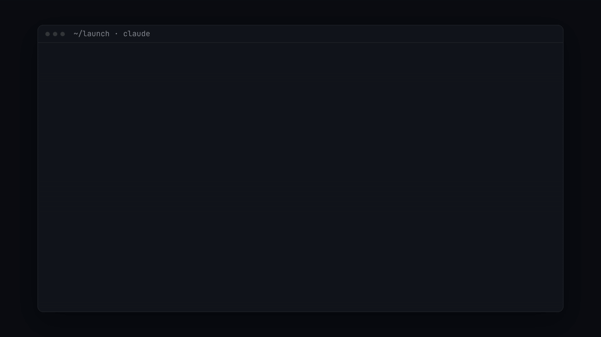

# siar

A social media scheduler with no web UI. It is an MCP server and a CLI: Claude Code, Cursor or any agent writes, validates, schedules and publishes posts, and reads the numbers back.



<sub>Replay of a real Claude Code session against a test instance with demo accounts; the commands, outputs and post texts are the session's own, shortened.</sub>

It does what [Postiz](https://github.com/gitroomhq/postiz-app) does for agents, without Postiz's five services (Next.js, NestJS, Temporal, Postgres, Redis):

- one Bun process, `bun:sqlite` in WAL mode
- zero runtime npm dependencies (`typescript` and `@types/bun` are dev-only)
- tokens sealed with AES-256-GCM before they touch the database
- media staged on disk, or on Cloudflare R2 (hand-rolled SigV4, no AWS SDK)
- a scheduler with retries, backoff and atomic claims, so two processes never double-post

Written from scratch (Postiz is AGPL-3.0; none of its code is copied).

## Status

siar is young (November 2026) and runs one production instance. Tested against live accounts so far:

- **Threads**: connect, publish.
- **LinkedIn profile**: connect, publish (text, images, video).
- **Instagram** (Unified Login): connect, account insights; publishing is scheduled but not yet verified live.
- **YouTube**: connect, read channel data. Google keeps API uploads private until your project passes the YouTube API audit.
- **LinkedIn Company Page**: code complete, waiting on LinkedIn's Community Management API approval.

Everything else in the table below is implemented from the platforms' API docs and covered by unit tests against fakes, but **untested live**. Reports and fixes are welcome.

## Platforms

| Platform | Connect | Text / media | Analytics |
|---|---|---|---|
| X | OAuth 2 (PKCE) | 280 (25k with `long`), 4 images or 1 video, threads | post + account |
| LinkedIn profile | OAuth | 3000, images, video, **PDF carousel** | post |
| LinkedIn Company Page | OAuth | same | post + followers |
| Instagram | Instagram Login (no Facebook Page needed) | posts, carousels (10), reels, **trial reels**, stories, collabs, AI label, reel cover, first comment | post + account |
| Instagram via Facebook Page | Meta OAuth | same | post + account |
| Facebook Page | Meta OAuth | text, link card, photos, reels, video, first comment | post + account |
| Threads | OAuth | 500, carousels (20), **polls**, text attachments, link cards, topic tag, AI label, reply chains with media | post + account |
| TikTok | OAuth | video, or **Photo Mode** (35 images) | post + account |
| YouTube | Google OAuth | videos and Shorts (`made_for_kids` required), custom thumbnail, notify subscribers, synthetic-media flag | post + account |
| Pinterest | OAuth | image, carousel, video Pins to a board | post + account |
| Reddit | OAuth | text, link, image posts | post + karma |
| Google Business Profile | Google OAuth | updates with photo and CTA | – |
| Bluesky | app password | 300 graphemes, 4 images or video, threads, rich-text facets | post + account |
| Mastodon | access token | 500, 4 media, threads, CW | post + account |
| Nostr | nsec | notes signed in-process (BIP-340 Schnorr, no deps), threads | – |
| Farcaster | Neynar signer | casts, channels, threads | post |
| Lemmy | login | link/text/image posts to a community | post |
| DEV, Hashnode, Medium, WordPress | API key / token | articles (Markdown, HTML for WordPress) | DEV, Hashnode |
| Telegram | bot token | text, photos, video, albums, files | members |
| Discord | channel webhook | text + 10 files, never pings `@everyone` | – |
| Slack | bot token | text and files | – |

Medium stopped issuing integration tokens; existing ones still work.

## Tools (51)

- **Posting:** `list_platforms`, `connect_account`, `list_accounts`, `check_account`, `disconnect_account`, `account_info`, `stage_media`, `list_media`, `delete_media`, `validate_post`, `create_draft`, `schedule_post`, `publish_now`, `update_post`, `list_posts`, `get_post`, `retry_post`, `cancel_post`, `delete_post`, `delete_published`, `get_publishing_limits`, `status`
- **Numbers:** `post_analytics`, `post_performance` (x usual), `post_metric_history`, `account_analytics`, `list_account_posts` (includes posts made in the app), `list_stories`, `best_times`
- **Comments** (Instagram, Threads, Facebook, YouTube): `list_comments`, `reply_to_comment`, `hide_comment`, `like_comment`, `delete_comment`, `set_comment_status`
- **Instagram DMs:** `list_conversations`, `get_conversation`, `send_dm` (incl. private replies to comments, link buttons), `get_contact`
- **Automations:** `create_automation`, `list_automations`, `update_automation`, `delete_automation`, `automation_activity`
- **Ideas board:** `create_idea`, `list_ideas`, `update_idea`, `delete_idea`
- **Threads:** `search_posts`, `get_post_context`, `reply_to_post` (also X)

Comment and DM text written by other people is returned as `{"untrusted": "…"}` so an agent treats it as data, not instructions.

## Automations

| Kind | Platforms | What it does |
|---|---|---|
| `comment_reply` | Instagram, Threads, Facebook, YouTube | public reply under matching comments: 3-5 variants, never the same one twice in a row, once per person per post, max 30/hour per account, `natural` or `relaxed` timing only |
| `comment_to_dm` | Instagram | optional public reply, then one private DM (with up to 3 link buttons) to the commenter |
| `dm_keyword` | Instagram | DM containing a keyword |
| `story_reply` / `story_mention` | Instagram | reply to the account's story / mention in someone's story |
| `default_reply` | Instagram | any DM nothing else answered, once per person per `cooldown_hours` |

Options: `keywords` + `match` (contains as a word, exact, any), `scope` (any post, given posts, or the next post published), `timing` (human-like delays), `react` (heart the DM first), `follow_gate` (ask to follow; only people Instagram says follow get the DM), `track_clicks` (link buttons go through `SIAR_PUBLIC_URL/l/…` and are counted).

Only what arrives after an automation is switched on is answered. siar polls comments and DMs every two minutes for accounts that have automations; with Meta webhooks pointed at `/webhooks/meta` Instagram DMs and follow-gate button taps are handled instantly (follow-gate taps need webhooks, or the person typing the button text).

A post has one text, media and options, and one target per account. A target can override the text, media or options for its account, so one post can carry an English LinkedIn version and a shorter X thread. Options are keyed by platform:

```json
{
  "content": "Shipped v2 today.",
  "media_ids": ["med_…"],
  "targets": ["acc_x…", { "account_id": "acc_li…", "content": "Longer LinkedIn version…" }],
  "options": { "x": { "thread": ["2/ details", "3/ link"] }, "linkedin": { "first_comment": "https://…" } }
}
```

Times are ISO 8601 and must carry an offset (`2026-11-17T08:00:00+07:00`); siar refuses ambiguous local times.

## Run

```sh
bun install                    # dev types only
bun src/index.ts keygen        # prints SIAR_VAULT_KEY and SIAR_API_TOKEN
cp .env.example .env           # fill in what you use
```

**Local, stdio** (Claude Code starts it; the scheduler runs while the session is open):

```sh
claude mcp add siar -- bun /path/to/siar/src/index.ts mcp
```

Bun reads `.env` from the working directory, so either start it from the repo or pass the variables with `-e`.

**Server** (always-on scheduler, OAuth callbacks, HTTP MCP at `/mcp` with a bearer token):

```sh
bun src/index.ts serve         # behind Caddy/nginx at SIAR_PUBLIC_URL
claude mcp add --transport http siar https://siar.example.com/mcp --header "Authorization: Bearer $SIAR_API_TOKEN"
```

If you run both against one data directory, set `SIAR_SCHEDULER=off` on the stdio one. Claims are atomic either way.

**CLI** (for agents that run shell commands: Claude Code, Codex, OpenClaw). Every MCP tool is also a command that prints JSON:

```sh
ln -s "$PWD/src/index.ts" ~/.local/bin/siar   # puts `siar` on your PATH
export SIAR_URL=https://siar.example.com SIAR_API_TOKEN=...   # talk to your server
siar tools                     # list the tools
siar help schedule-post        # arguments of one tool
siar schedule-post --content @post.md --targets '["acc_…"]' --at 2026-11-20T08:00:00+07:00
siar stage-media --path ./cover.jpg --alt "Dashboard screenshot"   # uploads the file to the server
```

The token stays in the environment, so it never enters the model's context. Without `SIAR_URL` the commands run locally against `SIAR_DATA_DIR` (no scheduler). [`skills/siar/SKILL.md`](skills/siar/SKILL.md) teaches an agent the workflow. In Claude Code, install it as a plugin:

```
/plugin marketplace add dzulfikar08/siar
/plugin install siar@siar
```

Other agents (OpenClaw, Codex): copy `skills/siar/` into their skills folder.

`deploy/` has a hardened systemd unit, a Cloudflare Tunnel config template and `deploy.sh <ssh-host>`, which ships the current commit to `/opt/siar/app` and restarts the service. It uses about 35 MB of RAM idle.

Set `SIAR_OPERATOR`, `SIAR_OPERATOR_LOCATION` and `SIAR_CONTACT`: siar serves a home page, `/privacy` and `/terms` with them, and Meta, Google and LinkedIn ask for those URLs when you register your apps.

## Connecting accounts

OAuth platforms need your own developer app on that platform (siar is self-hosted, so there is no shared app). Step-by-step guides: [Meta (Instagram, Threads, Facebook)](docs/setup/meta.md), [Google (YouTube, Business Profile)](docs/setup/google.md), [LinkedIn](docs/setup/linkedin.md), [other platforms](docs/setup/other.md). Set `<PLATFORM>_CLIENT_ID`/`_SECRET` and register `$SIAR_PUBLIC_URL/oauth/<platform>/callback` as the redirect URI. `connect_account` returns a URL; open it, approve, and the callback stores every account the grant covers (all your Pages, Company Pages, YouTube channels or Business locations).

Credential platforms take their fields in `connect_account` and are checked against the platform before they are saved.

Platform reviews still apply: TikTok apps post as `SELF_ONLY` until audited, LinkedIn Company Pages need the Community Management API on a second LinkedIn app (`LINKEDIN_PAGE_CLIENT_ID`/`_SECRET`), Instagram and Threads need Meta app review for accounts other than your own testers.

## Media

`stage_media` takes a URL, a path on the server, or base64; it sniffs the type and keeps a local copy. With R2 configured it also uploads there and uses the public R2 URL. Instagram, Threads, TikTok photos, Google Business and Nostr fetch media by URL, so they need R2 or a public `SIAR_PUBLIC_URL` (siar serves `/media/…` itself).

## Reliability

- Failed requests with 429/5xx or network errors retry with backoff (30 s doubling, up to 5 attempts). 4xx errors and validation failures fail at once.
- A 401 forces one token refresh and one retry; if that fails the account is marked `reauth_required`.
- Tokens are refreshed ten minutes before they expire, and rotated refresh tokens are saved.
- A target that was mid-upload when the process died is marked failed with a note to check the platform, not retried blindly.

## Development

```sh
bun test          # vault, Schnorr vectors, counting, MCP protocol, an end-to-end publish against a fake webhook
bun run typecheck
```

Tests run Discord end to end against a fake webhook, and Instagram/Threads publishing, comment-to-DM, the follow gate (through signed webhooks), best times and the ideas board against a fake Graph API. See [Status](#status) for what has been run against live accounts.

## Licence

[AGPL-3.0](LICENSE). You can run, change and self-host siar freely; if you offer a modified siar to others as a network service, you must publish your changes under the same licence.
